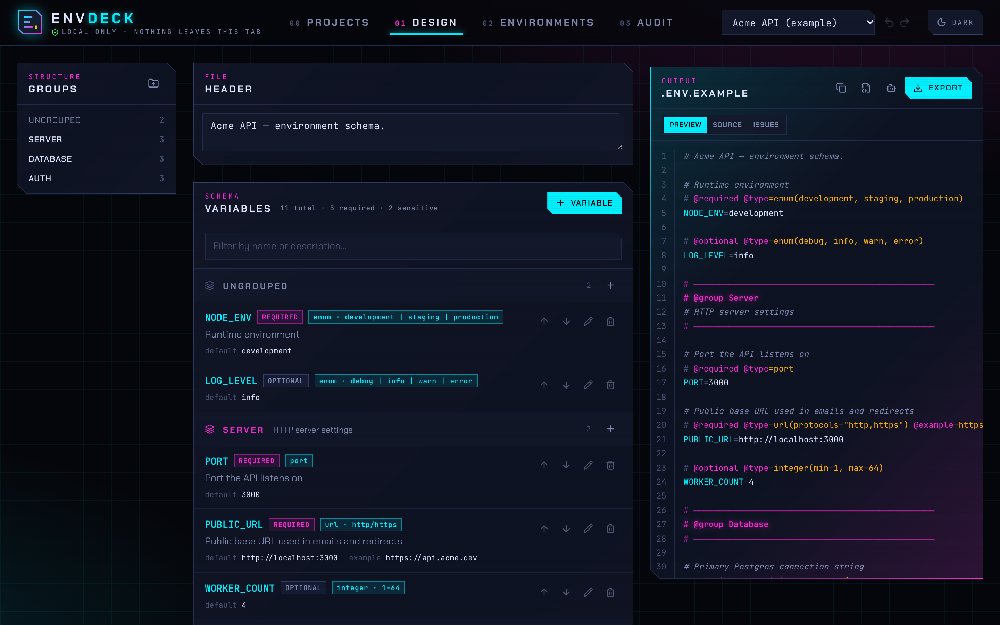
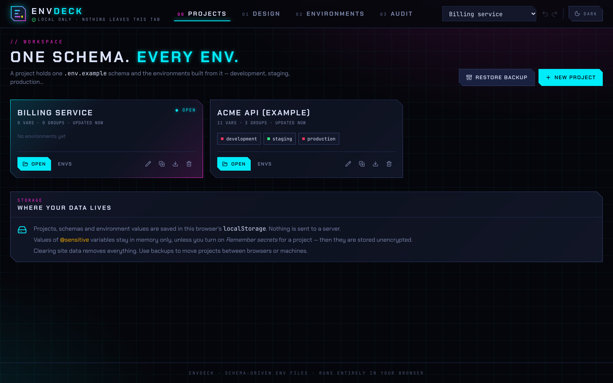
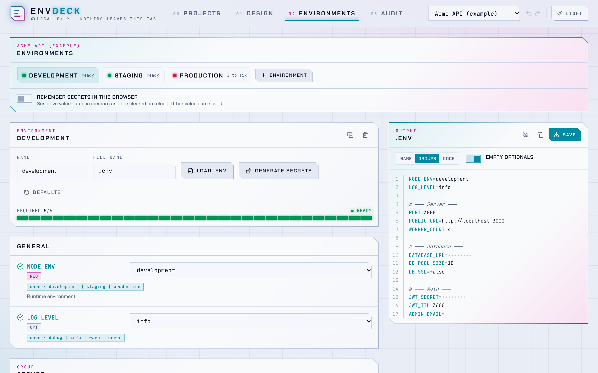
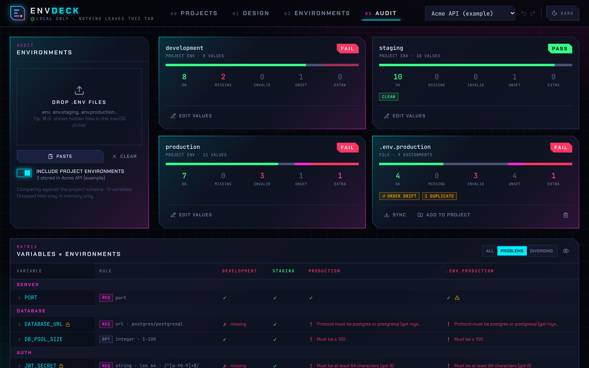

<div align="center">

# ENV<sub>//</sub>DECK

**One schema. Every env.**

Design your `.env.example` as a typed, grouped schema, keep every environment's values in one place,<br/>
and audit them for drift — all in your browser.

**[Open EnvDeck →](https://m4x1m1l14n.github.io/envdeck/)**



</div>

---

## Why

Every product ends up with the same mess: `.env` files on laptops, staging and production that slowly drift apart. Keys get renamed in one place and not another. Someone adds `NEW_FEATURE_FLAG` in production only. A port becomes `"8080 "` with a trailing space. Every server has the lines in a different order, so diffing them is useless. And `.env.example` — the one file that is supposed to describe all of this — is three months out of date.

EnvDeck makes the **annotated `.env.example` the single source of truth**. Types, rules, groups and docs live in plain comments, so the file stays a normal dotenv file that every loader can read, while EnvDeck can:

- **Organise** work into projects, each with its schema and its environments (development, staging, production…).
- **Design** the schema visually — add variables, set types, ranges, lengths, patterns, groups, mark them required / optional / sensitive.
- **Fill** each environment through a validated form with a secret generator, then save a clean, canonically ordered `.env`.
- **Audit** stored environments and any `.env` files you drop in, side by side: missing, invalid, unknown and duplicate keys, plus order drift.
- **Steer AI agents** with a ready-made guide so coding agents keep `.env.example` in the same format.
- **Check in CI** with the bundled `envdeck` CLI, which shares the exact same core.

There is no backend. The app is a static page; your data stays in your browser.

| Projects | Environments (light theme) |
| --- | --- |
|  |  |



## Using EnvDeck

**00 · Projects** — Create a project (empty, from an existing `.env.example`, or the example project), rename, duplicate, back up to a JSON file, restore, delete. Switch projects from the header.

**01 · Design** — Build the schema: file header, groups, variables with types and constraints, live preview of the annotated file. Every edit can be undone with <kbd>⌘Z</kbd> / <kbd>⌘⇧Z</kbd>. **Source** lets you edit the raw `.env.example`, with diagnostics as you type. **Issues** lists lint warnings, such as a sensitive variable with a committed value or a default that breaks its own rules. **Export** saves `.env.example`; the 🤖 button saves the AI agent guide.

When `.env.example` changes in your repository, click **Import** or drop the file anywhere on Design. A preview lists added, changed and removed variables, shows which environments each change affects, and offers renames. Pick the old name under *renamed from*, and stored values move to the new key. Obvious renames (same type and group) are pre-selected. Nothing changes until you click **Apply changes**.

**02 · Environments** — One tab per environment. Each is a form generated from the schema: selects for enums and booleans, masked inputs for secrets, a generator for sensitive strings (it respects length and hex patterns). Load an existing `.env` to import its values, see what's missing or invalid, and save the file. When the schema changes, values for keys that no longer exist are flagged so you can clean them up.

**03 · Audit** — Every environment of the project plus any `.env` files you drop or paste (for example, pulled from servers) side by side. Each gets a PASS/FAIL card. The matrix shows every variable across every environment. Filter to **Problems** or **Diverging** (values or status differ between environments) and expand a row for details. Dropped files can be **synced** (rewritten in schema order, deduplicated, missing keys added) or **added to the project** as a new environment.

> **Tip:** macOS hides dotfiles in the file picker. Press <kbd>⌘⇧.</kbd> to show them, or just drag & drop.

### Where your data lives

- Everything is stored in your browser's `localStorage` — projects, schemas and environment values. Nothing is sent anywhere; the app makes no network requests after it loads.
- **Values of `@sensitive` variables are kept in memory only** and are gone on reload — unless you enable **Remember secrets in this browser** for a project. Then they are stored **unencrypted** in `localStorage`; only do that on a machine you trust.
- `localStorage` is per origin. On GitHub Pages, every project site of the same user shares `https://<user>.github.io`, so another Pages site under that account could read it. Keep secrets off, or self-host on your own domain or `localhost` if that matters to you.
- Backups (`*.envdeck.json`) contain all values currently held, including secrets in memory. Treat them like a `.env` file.
- Clearing site data deletes everything. Back up projects you care about.

## The schema format

An EnvDeck schema is a regular `.env.example`. Annotations are comments directly above each variable.

```bash
# Acme API — environment schema.

# Runtime environment
# @required @type=enum(development, staging, production)
NODE_ENV=development

# ━━━━━━━━━━━━━━━━━━━━━━━━━━━━━━━━━━━━━━━━━━━━━━━━
# @group Database
# Everything Postgres
# ━━━━━━━━━━━━━━━━━━━━━━━━━━━━━━━━━━━━━━━━━━━━━━━━

# Primary connection string
# @required @sensitive @type=url(protocols="postgres,postgresql")
DATABASE_URL=

# Connection pool size
# @optional @type=integer(min=1, max=100)
DB_POOL_SIZE=10

# Secret used to sign JWTs. Generate with: openssl rand -hex 32
# @required @sensitive @type=string(minLength=64, maxLength=64, pattern="^[a-f0-9]+$")
JWT_SECRET=
```

### Rules of the format

- **Description** — plain comment lines directly above a variable (no blank line in between).
- **Decorators** — comment lines starting with `@`. Several per line are fine. A trailing inline comment works too: `PORT=3000 # @optional @type=port`.
- **Value** — the value in `.env.example` is the default, used to pre-fill environments. Leave sensitive values empty.
- **Groups** — a comment line containing `@group Name` starts a group. Every following variable belongs to it until the next group. Decoration like `━━━`, `---` or `===` around it is ignored. Lines between the `@group` line and a closing rule become the group description.
- **File header** — a comment block at the top, separated by a blank line, is the file description. It may contain `@defaultRequired=false`.
- **Defaults** — a variable without `@required` / `@optional` is required (unless the header says otherwise) and its type is `string`. So any existing, un-annotated `.env.example` is already a valid schema.
- **Ordering** — variables before the first group come first, then groups in file order. This is the canonical order used when generating and syncing env files.

### Decorators

| Decorator | Meaning |
| --- | --- |
| `@required` / `@optional` | Whether an empty or absent value fails validation. |
| `@sensitive` (alias `@secret`) | Masked in the UI and CLI, not persisted by default. Should have no value in the example. |
| `@type=…` | Type and constraints, see below. |
| `@example=…` | Hint shown when filling values. Quote it if it has spaces: `@example="a b"`. |
| `@docs=https://…` | Link to documentation. `@docs("Label", https://…)` also works. |
| `@group Name` | Starts a group (on its own line). |
| `@defaultRequired=false` | File header only: make un-annotated variables optional. |

### Types

| Type | Options | Accepts |
| --- | --- | --- |
| `string` | `minLength`, `maxLength`, `pattern`, `startsWith`, `endsWith` | Anything. Length is counted in Unicode code points. |
| `number` | `min`, `max` | `1`, `-2.5`, `1e3` |
| `integer` (`int`) | `min`, `max` | `42`, `-7` |
| `port` | `min`, `max` | Integer, 1–65535 by default |
| `boolean` (`bool`) | — | `true/false`, `1/0`, `yes/no`, `on/off` (case-insensitive) |
| `enum` | positional values | `enum(dev, staging, "prod eu")` — exact match |
| `url` | `protocols` | Any URL parsable by WHATWG `URL`; `protocols="https,wss"` restricts schemes |
| `email` | — | `name@domain.tld` |
| `uuid` | — | RFC 4122 format |
| `json` | — | Valid JSON |

Patterns are JavaScript regular expressions. Wrap them in double quotes. Backslashes are kept as written (`pattern="^\d+$"`). Only `\"` is unescaped.

### Value parsing

`.env` files are read the way common dotenv loaders read them: optional `export` prefix, `#` comments, inline comments after whitespace (`KEY=value # note`), single quotes (literal), double quotes (with `\n`, `\t`, `\"`, `\\` escapes), and multi-line double-quoted values. When EnvDeck writes files, it quotes a value only when necessary, so output round-trips through any loader.

## Steering AI coding agents

[`docs/agents/ENVDECK.md`](docs/agents/ENVDECK.md) is a compact rulebook for coding agents: always declare new variables in `.env.example`, never commit secrets, never touch real `.env` files, pick the narrowest type, keep the canonical layout, and flag breaking renames.

To use it in a project:

1. Get it from the **Agent guide** button in the app header (or the panel on the Projects page): **Copy guide**, **Download ENVDECK.md**, or [view it on GitHub](docs/agents/ENVDECK.md). Save it as `ENVDECK.md` next to your `.env.example`.
2. Point your agent at it — for example, add to `AGENTS.md` / `CLAUDE.md` / `.cursorrules`:

   ```md
   Environment variables follow the rules in ENVDECK.md. Read it before adding, renaming or removing any env var.
   ```

## CLI (optional)

The repository also contains a small CLI that runs the same checks in a terminal or CI. It is not published to npm; build it from a clone:

```bash
git clone https://github.com/m4x1m1l14n/envdeck.git
cd envdeck && npm install && npm run build:cli
node dist-cli/envdeck.js check --help      # or `npm link` to get an `envdeck` command
```

```
envdeck check [env files...]   Validate env files against the schema (default: .env)
envdeck fmt                    Rewrite the schema file in canonical form
envdeck sync <env file>        Reorder an env file to match the schema

Options
  -s, --schema <file>   Schema file (default: .env.example)
      --strict          check: also fail on unknown keys, duplicates and order drift
      --json            check: print a machine-readable report
  -w, --write           fmt/sync: write the result back instead of printing it
      --check           fmt: exit 1 if the file is not formatted
      --drop-extras     sync: remove keys that are not in the schema
      --fill-defaults   sync: fill missing values with schema defaults
```

```console
$ envdeck check .env.staging .env.production

◆ envdeck .env.staging vs .env.example
  7 ok · 0 missing · 0 invalid · 4 unset · 0 extra  PASS

◆ envdeck .env.production vs .env.example
  ⚠ PORT               warning   Defined 2 times; the last value wins
  ✖ DATABASE_URL       invalid   Protocol must be postgres or postgresql (got mysql)
  ✖ DB_POOL_SIZE       invalid   Must be ≤ 100
  ✖ JWT_SECRET         invalid   Must be at least 64 characters (got 8); Must match /^[a-f0-9]+$/
  ! LEGACY_REDIS_HOST  extra     not declared in schema
  ↕ order drift: keys are not in schema order (run envdeck sync .env.production -w)
  4 ok · 0 missing · 3 invalid · 4 unset · 1 extra  FAIL
```

**Values are never printed**, in text or JSON output, so `check` is safe to run in CI logs. Exit codes: `0` passed, `1` validation failed, `2` usage error or missing file.

## How it compares to varlock

[varlock](https://varlock.dev) pioneered the `@decorator`-in-comments style, and EnvDeck uses a compatible subset (`@required`, `@optional`, `@sensitive`, `@type=…`, and `number(isInt=true)` is read as `integer`). The tools differ in scope:

- **varlock** is a runtime loader. It resolves values (including from secret managers), injects them into your process and generates types.
- **EnvDeck** works on plain `.env` files. It's a visual editor, a per-environment value store and a multi-environment drift auditor, with no runtime dependency in your app.

## Development

```bash
npm install
npm run dev         # web app with hot reload
npm test            # unit tests (Vitest): parser, validator, audit, generator, CLI, store
npm run test:e2e    # end-to-end tests (Playwright); first run: npx playwright install chromium
npm run typecheck
npm run build       # static site → dist/ (relative paths, works under any sub-path)
npm run build:cli   # CLI → dist-cli/envdeck.js
```

```
src/
  core/   pure TypeScript, no DOM: lexer, decorator parser, schema parse/serialize,
          validation, audit, env generation, schema edit operations
  cli/    `envdeck` command (thin wrapper over core, fully unit tested)
  app/    React UI — store (zustand + localStorage), views (Projects, Design, Environments, Audit)
e2e/      Playwright specs
docs/     screenshots and the AI agent guide
examples/ demo schema and two environments with deliberate drift
```

Pushes to `main` are tested and deployed to GitHub Pages by [`.github/workflows/pages.yml`](.github/workflows/pages.yml). To host it yourself, serve the `dist/` folder from any static web server.

## License

[MIT](LICENSE)
